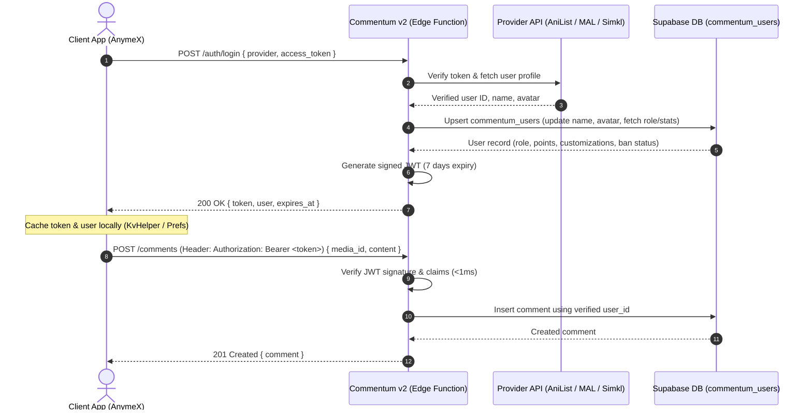

# Commentum v2 — Architecture & API Revamp Plan

**Target Branch:** `revamp`  
**Status:** In Planning / Ready for Implementation  
**Date:** October 2026  

---

## 1. Executive Summary & Goals

Commentum v2 currently serves as the comments and community backend for AnymeX (and bridges with Dantotsu). However, its current API architecture suffers from critical security, performance, and payload design flaws:

1. **Insecure & Spoofable User Identity:** Endpoints currently accept a raw `user_info` JSON object in request bodies (`user_id`, `username`, `avatar`, etc.). Any malicious client can spoof IDs and post comments as other users.
2. **Slow External Auth Overhead:** For moderation actions, the backend hits third-party APIs (AniList, MyAnimeList, Simkl) on *every single request* to verify the user's token. This causes high latency (300ms–1500ms) and risks hitting third-party rate limits.
3. **Payload Bloat:** Every comment submission sends redundant user metadata (username, avatar, decorations, client type) that the server already knows or could resolve.
4. **Inconsistent Endpoint Structure:** Actions are packed into generic endpoints using an `action` body parameter (e.g. `action: "create" | "edit" | "delete"` inside `/comments`), leading to brittle switch-case handlers and non-standard HTTP semantics.

### The Revamp Vision
Adopt a **Session Token (JWT) architecture inspired by Dantotsu's comments system**, optimized for multi-client support (AniList, MAL, Simkl):
- **Authenticate Once:** Client exchanges its OAuth token (`access_token`) for a signed `commentum_token` (JWT / Session Token).
- **Backend Syncs User Info:** Backend verifies the token once with the provider API, updates/creates the user in the database, and loads roles/customizations.
- **Subsequent Requests Use Token:** All write operations and protected reads use `Authorization: Bearer <commentum_token>`.
- **Clean RESTful Endpoints:** Omit `user_info`, redundant payloads, and nested switch-cases in favor of lean, fast endpoints.

---

## 2. Dantotsu Architecture Analysis & Key Takeaways

### How Dantotsu Handles Comments (`CommentsAPI.kt`)
In Dantotsu:
1. **Authentication:**
   - Client sends `POST /authenticate` with `{ token: "<anilist_oauth_token>" }` and a secret header (`appauth`).
   - Server validates the token with AniList GraphQL API (`Viewer { id name avatar }`).
   - Server upserts the user in its DB and returns:
     ```json
     {
       "authToken": "eyJhbGciOi...",
       "user": {
         "user_id": "12345",
         "username": "...",
         "profile_picture_url": "...",
         "is_banned": false,
         "is_mod": false,
         "is_admin": false,
         "total_votes": 12,
         "warnings": 0
       }
     }
     ```
   - Dantotsu stores `authToken` locally for 6 days.
2. **Comment Operations:**
   - Headers: `Authorization: <authToken>`
   - Body: Simple and clean!
     ```json
     {
       "media_id": 12345,
       "content": "Episode was amazing!",
       "tag": 0,
       "parent_comment_id": null
     }
     ```
   - **Crucial detail:** Dantotsu **NEVER** sends `username`, `avatar`, `role`, or `user_id` when creating a comment. The server extracts the authenticated identity directly from the `authToken`!

### What Commentum v2 Needs to Improve Over Dantotsu
- **Multi-Provider Support:** Dantotsu only supports AniList. Commentum v2 must support **AniList**, **MyAnimeList**, and **Simkl**.
- **Unified Identity & Role System:** Commentum v2 already has a rich role hierarchy (`owner`, `super_admin`, `admin`, `moderator`, `user`), points/leaderboards, and customization frames/banners. The auth response should return these in one neat profile payload.
- **Stateless JWT with Fast Verification:** Use HMAC-SHA256 JWTs with standard claims (`sub`, `provider`, `role`, `exp`) so Supabase Edge Functions can verify authenticity in <1ms without database roundtrips.

---

## 3. End-to-End Authentication Architecture

### 3.1. Auth Flow Diagram



### 3.2. Step-by-Step Breakdown

1. **One-Time Token Exchange (`POST /auth/login`)**:
   - Client sends its OAuth access token and provider (`anilist`, `mal`, or `simkl`).
   - Backend calls the corresponding provider endpoint:
     - **AniList:** `https://graphql.anilist.co` (`Viewer { id name avatar { large } }`)
     - **MAL:** `https://api.myanimelist.net/v2/users/@me?fields=picture`
     - **Simkl:** `https://api.simkl.com/users/settings`
   - If invalid/expired: return `401 Unauthorized`.
   - If valid: Backend upserts `commentum_users` row with `commentum_user_id = provider:provider_user_id` or existing ID format.
   - Backend signs a JWT with:
     ```json
     {
       "sub": "user_12345",
       "provider": "anilist",
       "provider_uid": "12345",
       "role": "user",
       "iat": 1729158400,
       "exp": 1729763200
     }
     ```
   - Response returns:
     ```json
     {
       "token": "eyJhbGciOi...",
       "expires_at": 1729763200,
       "user": {
         "id": "12345",
         "provider": "anilist",
         "username": "Sheby",
         "avatar_url": "https://...",
         "role": "user",
         "is_banned": false,
         "total_points": 450,
         "streak": 5,
         "customizations": {
           "avatar_decoration": "cyber_glow",
           "banner_url": "https://...",
           "nameplate_theme": "neon"
         }
       }
     }
     ```

2. **Subsequent API Requests**:
   - Client attaches standard header:
     ```http
     Authorization: Bearer <token>
     ```
   - Edge functions use a unified middleware `getAuthenticatedUser(req)`:
     - Validates JWT signature with `JWT_SECRET`.
     - Validates expiration time.
     - Checks if user is banned or suspended.
     - Supplies verified `{ userId, provider, role }` to the route handler.

3. **Session Refresh & Expiry (`POST /auth/refresh`)**:
   - Clients refresh automatically when token has < 24 hours left or on app launch.

---

## 4. Omissions & Cleanups (Removing Bloat)

### What to OMIT from the Current V2 API:

| Current Flaw | What to OMIT | New Way |
| :--- | :--- | :--- |
| **`user_info` in Request Bodies** | OMIT `{ "user_info": { "user_id": ..., "username": ... } }` | Identity extracted automatically from `Authorization` header. |
| **Repeated `client_type` & `access_token` in Bodies** | OMIT passing provider tokens for mod actions | Verified via JWT `role` claim. Role is checked against DB only when required. |
| **Generic `action` Switch-Cases** | OMIT `POST /comments { "action": "create" }`, `POST /comments { "action": "edit" }` | Standard HTTP verbs (`POST /comments`, `PATCH /comments/:id`, `DELETE /comments/:id`). |
| **Repeated Provider API Calls** | OMIT checking AniList/MAL on every comment or moderation request | Check provider ONLY during `/auth/login`. |
| **Client-Calculated Data** | OMIT sending client timestamps or unverified decoration URLs | Server reads customizations directly from user profile in DB. |
| **Inconsistent Error Responses** | OMIT unstructured strings or varied status code schemes | Uniform format: `{ "success": false, "error": { "code": "AUTH_EXPIRED", "message": "..." } }`. |

---

## 5. New RESTful Endpoints Specification

### 5.1. Authentication Endpoints (`/auth`)
- **`POST /auth/login`**
  - **Body:** `{ "provider": "anilist" | "mal" | "simkl", "access_token": "string" }`
  - **Response:** `{ "token": "string", "expires_at": number, "user": UserProfile }`
- **`GET /auth/me`**
  - **Headers:** `Authorization: Bearer <token>`
  - **Response:** `{ "user": UserProfile }`
- **`POST /auth/refresh`**
  - **Headers:** `Authorization: Bearer <token>`
  - **Response:** `{ "token": "string", "expires_at": number }`

---

### 5.2. Comments Endpoints (`/comments`)
- **`GET /comments` (or `/media/:mediaId/comments`)**
  - **Query Params:**
    - `media_id`: (Required) ID of anime/manga/novel
    - `client_type`: `anilist` | `mal` | `simkl`
    - `sort`: `newest` | `oldest` | `top`
    - `tag`: optional episode/chapter tag (e.g. `1`, `all`)
    - `page`: default 1
    - `limit`: default 50
  - **Auth:** Optional (if provided, marks comments with `user_vote`: 1 / -1 / 0)
  - **Response:**
    ```json
    {
      "items": [
        {
          "id": 101,
          "media_id": "16498",
          "content": "Masterpiece episode!",
          "tag": "12",
          "parent_id": null,
          "created_at": "2026-10-17T10:00:00Z",
          "vote_score": 14,
          "user_vote": 1,
          "is_pinned": false,
          "is_locked": false,
          "reply_count": 3,
          "author": {
            "id": "user_123",
            "username": "Sheby",
            "avatar_url": "https://...",
            "role": "user",
            "customizations": {
              "avatar_decoration": "neon_frame",
              "nameplate_theme": "cyber"
            }
          }
        }
      ],
      "pagination": {
        "page": 1,
        "limit": 50,
        "total": 128,
        "total_pages": 3,
        "has_more": true
      }
    }
    ```

- **`POST /comments`**
  - **Auth:** Required (`Bearer <token>`)
  - **Body:**
    ```json
    {
      "media_id": "16498",
      "media_type": "anime",
      "media_title": "Attack on Titan",
      "content": "Can't wait for next week!",
      "tag": "12",
      "parent_id": null
    }
    ```
  - **Response:** `201 Created` with created comment object.

- **`PATCH /comments/:id`**
  - **Auth:** Required (`Bearer <token>`)
  - **Body:** `{ "content": "Updated content..." }`
  - **Validation:** Author must match token `userId`.

- **`DELETE /comments/:id`**
  - **Auth:** Required (`Bearer <token>`)
  - **Validation:** Author matches token `userId` OR token role >= `moderator`.

- **`GET /comments/:id/replies`**
  - **Query Params:** `page`, `limit`
  - **Response:** Threaded reply list + pagination.

---

### 5.3. Votes Endpoints (`/votes`)
- **`POST /comments/:id/vote`**
  - **Auth:** Required (`Bearer <token>`)
  - **Body:** `{ "type": 1 | -1 | 0 }` (1 = upvote, -1 = downvote, 0 = remove vote)
  - **Response:**
    ```json
    {
      "success": true,
      "comment_id": 101,
      "vote_score": 15,
      "user_vote": 1
    }
    ```

---

### 5.4. Reports & Moderation (`/reports`, `/mod`)
- **`POST /comments/:id/report`**
  - **Auth:** Required (`Bearer <token>`)
  - **Body:** `{ "reason": "spoiler" | "harassment" | "spam" | "other", "details": "..." }`
- **`POST /mod/comments/:id/pin`** (Min Role: `moderator`)
- **`POST /mod/comments/:id/lock`** (Min Role: `moderator`)
- **`POST /mod/users/:id/warn`** (Min Role: `moderator`)
- **`POST /mod/users/:id/ban`** (Min Role: `admin`)

---

### 5.5. User Profile & Customizations (`/users`)
- **`GET /users/:id`** - Public profile with stats, badges, points, rank.
- **`PATCH /users/me/customizations`**
  - **Auth:** Required (`Bearer <token>`)
  - **Body:** `{ "avatar_decoration": "...", "nameplate_theme": "...", "banner_url": "..." }`

---

## 6. Client Implementation Plan (AnymeX)

### 6.1. Updating `CommentumService` in AnymeX

1. **Stateful Session Storage:**
   - Store `commentum_jwt_token` and `commentum_token_expiry` in `KvHelper`.
   - On app startup or user login:
     ```dart
     Future<void> ensureAuthenticated() async {
       if (hasValidCachedToken()) return;
       final clientToken = await getProviderOAuthToken(); // AniList/MAL/Simkl
       final res = await http.post(
         Uri.parse('$baseUrl/auth/login'),
         headers: {'Content-Type': 'application/json'},
         body: jsonEncode({
           'provider': currentProviderName,
           'access_token': clientToken,
         }),
       );
       final data = jsonDecode(res.body);
       saveToken(data['token'], data['expires_at']);
       updateCurrentUser(data['user']);
     }
     ```

2. **Clean Request Building:**
   - Standard headers:
     ```dart
     Map<String, String> get authHeaders => {
       'Content-Type': 'application/json',
       if (token != null) 'Authorization': 'Bearer $token',
     };
     ```
   - Comment creation simplifies from 60 lines of map assembling to:
     ```dart
     Future<Comment?> createComment({
       required String mediaId,
       required String content,
       required String tag,
       int? parentId,
     }) async {
       await ensureAuthenticated();
       final response = await http.post(
         Uri.parse('$baseUrl/comments'),
         headers: authHeaders,
         body: jsonEncode({
           'media_id': mediaId,
           'content': content,
           'tag': tag,
           'parent_id': parentId,
         }),
       );
       return parseComment(response.body);
     }
     ```

---

## 7. Implementation Roadmap & Phases

```
Phase 1: Auth & Token Foundation (Edge Functions)
  ├── 1.1 Implement JWT helper (sign, verify, claims) in supabase/functions/shared/jwt.ts
  ├── 1.2 Implement POST /auth/login handler with multi-provider token verification
  ├── 1.3 Add GET /auth/me and POST /auth/refresh
  └── 1.4 Test with AniList, MAL, and Simkl test tokens

Phase 2: Comments & Votes Modernization
  ├── 2.1 Refactor /comments to use JWT middleware (remove user_info requirement)
  ├── 2.2 Support GET /comments with optional auth (to return user_vote status)
  ├── 2.3 Refactor /votes to use JWT middleware
  └── 2.4 Verify backwards-compatibility or deprecation path

Phase 3: Moderation, Reports & Customizations
  ├── 3.1 Refactor /moderation and /reports with role check from JWT
  ├── 3.2 Refactor /customizations to update current user safely
  └── 3.3 Strip sensitive data from public outputs

Phase 4: Client Integration & Validation
  ├── 4.1 Update AnymeX CommentumService with auto-login & bearer token handling
  ├── 4.2 Verify Dantotsu bridge compatibility
  └── 4.3 End-to-end testing with AnymeX live comments
```

---

## 8. Verification & Success Criteria

1. **Security:** No unauthenticated user can post, vote, or spoof identity. Requesting `/comments` without a valid token for write actions returns `401 Unauthorized`.
2. **Performance:** Comment creation latency reduced by eliminating third-party API calls on the hot path. Average response time < 150ms.
3. **Payload Optimization:** Comment submission payload size reduced by ~70% (no user object, no token parameters in body).
4. **Reliability:** Token expiry handling is smooth with automatic refresh, preventing unexpected auth failures during active reading/watching sessions.
